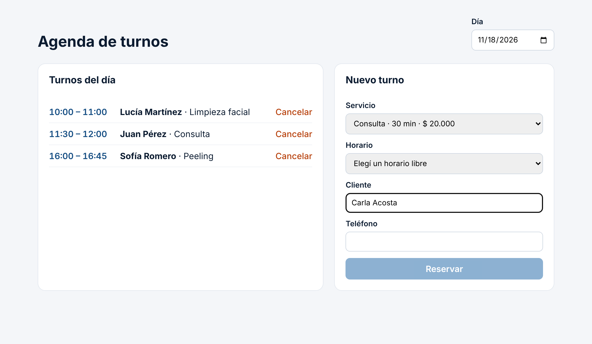

# Agenda de turnos

Sistema de turnos para un consultorio o centro de estética: muestra los horarios libres de cada servicio, reserva sin que dos turnos se pisen y respeta el horario de atención.

*Appointment booking app: ASP.NET Core 8 Web API + Entity Framework Core + SQL Server, with an Angular 18 front end and xUnit tests.*



## Qué hace

- Lista los turnos de un día.
- Calcula los **horarios libres** de un servicio cada 30 minutos, según su duración y lo que ya está ocupado.
- Reserva un turno validando que:
  - no se superponga con otro (un turno puede empezar justo cuando termina el anterior),
  - esté dentro del horario de atención (lunes a sábado, de 9 a 19),
  - no sea en el pasado.
- Cancela turnos.

## Tecnologías

| Parte | Stack |
| --- | --- |
| API | C#, ASP.NET Core 8 (controllers), Entity Framework Core 8, Swagger |
| Base de datos | SQL Server 2022 (en Docker) |
| Front | Angular 18 (componentes standalone, `HttpClient`, formularios con `ngModel`) |
| Pruebas | xUnit con la base en memoria de EF Core |
| CI | GitHub Actions: corre las pruebas de la API y compila el front en cada push |

## Cómo está organizado

```
backend/
  AgendaTurnos.Api/
    Controllers/    endpoints: /api/servicios y /api/turnos
    Services/       AgendaService: todas las reglas de negocio
    Data/           AppDbContext y los servicios de ejemplo
    Models/  Dtos/
  AgendaTurnos.Tests/   pruebas de las reglas de la agenda
frontend/           app de Angular
docker-compose.yml  SQL Server + API
```

Las reglas están en `AgendaService` y no en los controllers: así se prueban sin levantar la API, y el controller solo traduce el resultado a una respuesta HTTP (201, 400 o 409).

## Endpoints

| Método | Ruta | Qué hace |
| --- | --- | --- |
| GET | `/api/servicios` | Servicios con duración y precio |
| GET | `/api/turnos?fecha=2026-11-20` | Turnos del día |
| GET | `/api/turnos/libres?fecha=2026-11-20&servicioId=2` | Horarios libres para ese servicio |
| POST | `/api/turnos` | Reserva. Responde 409 si el horario está ocupado y 400 si no es válido |
| DELETE | `/api/turnos/{id}` | Cancela un turno |

## Correrlo

Con Docker:

```bash
docker compose up --build        # SQL Server + API en http://localhost:5080/swagger
cd frontend && npm install && npm start   # front en http://localhost:4200
```

Sin Docker para la API (necesitás SQL Server local y el .NET 8 SDK):

```bash
cd backend
dotnet test                       # pruebas
dotnet run --project AgendaTurnos.Api
```

La contraseña de `docker-compose.yml` y `appsettings.json` es solo para desarrollo local.

## Próximos pasos

- Migraciones de EF Core en lugar de `EnsureCreated`.
- Varios profesionales con agenda propia.
- Recordatorio por WhatsApp el día anterior al turno.
